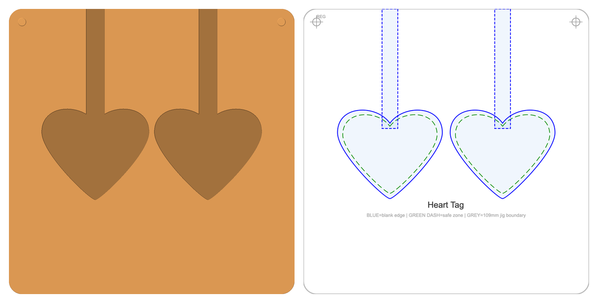

# laser-jig

Make 3D-printable jigs for laser engraving from a spreadsheet of blank sizes. For each blank you get:

- an **STL** to print: a plate with pockets that hold the blanks in the same place every time, plus two raised
  registration dots;
- an **SVG** template at 1:1 scale: where each blank sits (blue), a 2 mm engraving safe zone (green dashed) and
  crosshairs over the two dots, to load into your laser software as a locked reference layer.



## Install

Needs Python 3.11 or newer.

```bash
pipx install git+https://github.com/hassanitani6/laser-jig
```

The CAD library it uses (build123d) is a large install, about 600 MB.

## Use

```bash
laser-jig generate examples/blanks.csv            # STL + SVG for every row, into ./jigs
laser-jig generate my_blanks.csv -o jigs --only svg
laser-jig generate my_blanks.csv --width 150 --height 120 --thickness 10
```

Existing files are never replaced unless you add `--overwrite`. Every row is checked before anything is made; if a
row has a problem (unknown shape, pockets that don't fit the plate, a blank too thick for the plate), all problems
are listed with their line numbers and nothing is written.

### The plate

The default plate is 109 x 109 mm, 9 mm thick, with 5 mm rounded corners. Change it with `--width`, `--height`,
`--thickness` and `--corner-radius` (millimetres) to suit your laser's bed, fixture or honeycomb.

### The CSV

One row per blank. Sizes are in millimetres.

| Column | Meaning |
|---|---|
| `product` | file name for this jig (letters, digits, `_`, `-`) |
| `folder` | optional sub-folder for the files |
| `blank_w_mm`, `blank_h_mm` | blank width and height (`blank_h_mm` is `0` for circles; `blank_w_mm` is the diameter) |
| `blank_z_mm` | blank thickness; pockets are 0.5 mm deeper than thin blanks, and thick blanks sit proud with 1 mm of floor |
| `shape` | `rect`, `circle`, `heart`, `tombstone` (round top, square bottom) or `wallet` (rounded rectangle) |
| `layout` | pockets as columns x rows, e.g. `4x1` (`1x1` for circle, tombstone and wallet) |
| `pocket_type` | see below |
| `tolerance` | `tight` (0.5 mm clearance each side) or `loose` (0.8 mm) |
| `tab_w_mm`, `tab_l_mm` | optional slot for a key ring or tab: width across and length. No wider than the blank; ring slots need a single row of pockets (layout `Nx1`), because each slot runs to the plate edge |
| `notes` | ignored |

Pocket types. "Back edge" is the edge with the two registration dots (the top of the SVG); "front edge" is the
opposite edge (the bottom of the SVG, where the generated template prints "blank overruns plate front edge").


| Shape | `pocket_type` | Pocket |
|---|---|---|
| rect | `4wall` | closed pocket; a tab slot runs to the front edge if `tab_w_mm` and `tab_l_mm` are set (the slot is cut in the STL but not drawn on the SVG template) |
| rect | `3wall` | long blanks stood front to back; with `tab_w_mm` set, a slot runs from each pocket to the front edge for a ring |
| rect | `3wall_top_notch` | as `3wall`, with the ring slot at the back |
| rect | `3wall_overrun` | blanks longer than the plate run off the front edge |
| circle | `cylinder`, `cylinder_notch`, `cylinder_removal_notch` | round pocket; with a ring slot to the front edge (12 mm wide when `tab_w_mm` is empty); with a finger notch to lift the blank out |
| heart | `heart_profile` | heart pocket, ring slot at the notch if a tab is set |
| tombstone | `tombstone_pocket` | the round end may run past the back edge |
| wallet | `wallet_pocket` | rounded-rectangle pocket (blank at least 10 mm each way) |

See [`examples/blanks.csv`](examples/blanks.csv).

### Printing and lining up

Print the STL flat (0.2 mm layers, 3 walls and 15% infill in PLA work well). Place the jig on the laser bed with the
registration dots at the back of the bed (the top of the screen in your laser software), so it matches the SVG. If
the jig is turned round, the template no longer lines up and asymmetric blanks such as hearts are engraved upside
down relative to their pockets. Then load the
SVG as a locked layer, and use your software's two-point positioning on the left then the right registration dot.
Run a low-power test on paper first.

## Report a problem

Run `laser-jig doctor` and include its output (it hides your user name and home folder) in a
[bug report](https://github.com/hassanitani6/laser-jig/issues/new/choose). Security problems: see
[SECURITY.md](SECURITY.md).

## Licence

MIT — see [LICENSE](LICENSE). Uses [build123d](https://github.com/gumyr/build123d) (Apache-2.0).
